<p align="center">
  <picture>
    <source media="(prefers-color-scheme: dark)" srcset="docs/logo-dark.png">
    <source media="(prefers-color-scheme: light)" srcset="docs/logo-light.png">
    
  </picture>
</p>

<p align="center">
  ReelForge lets Claude Code or Codex make faceless short videos for TikTok, YouTube Shorts, Instagram Reels and X,
  then shows you how each one does once you've posted it. It runs on Windows, macOS and Linux.
</p>

<p align="center">
  <a href="#quick-start"></a>
</p>

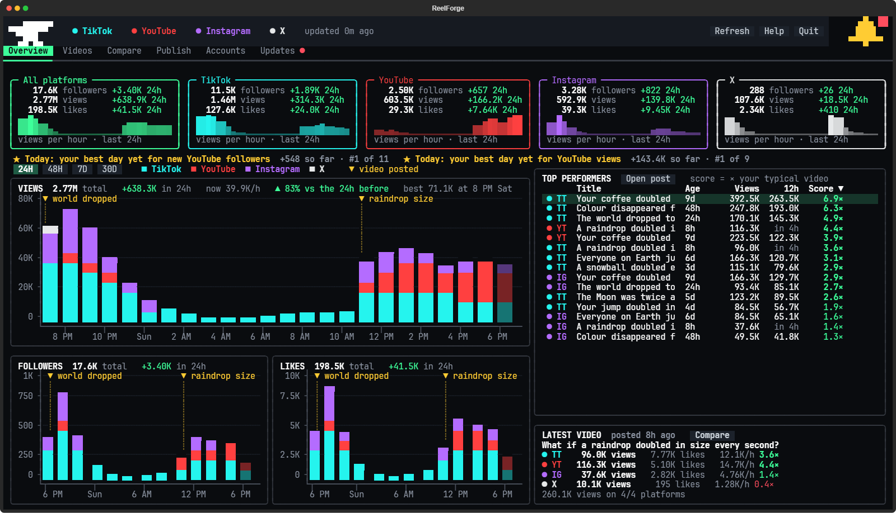

## What it makes

An AI made these three videos with ReelForge, start to finish: it wrote the script, checked every number against a
real source, built and rendered the 3D scenes, and added the text and the sound. They're ReelForge's three demos.

<p align="center">
  &nbsp;
  &nbsp;
  
</p>

You start from a format that's already pulling views, like "What if X doubled every 2 seconds?" or "What if everyone
on Earth did X at once?", or you describe your own.

## Quick start

You need about 15 GB of free space, Claude Code or Codex, and one of these:

- a **Windows 10 or 11** PC with a recent NVIDIA or AMD graphics card
- a **Mac** with Apple Silicon (M1 or newer); an Intel Mac works too, but renders much more slowly
- a **Linux** PC (x64) with a recent NVIDIA or AMD graphics card and its drivers

1. **Open a terminal.** On Windows, press the Windows key, type `PowerShell` and press Enter. On a Mac, press
   ⌘ Space, type `Terminal` and press Enter. On Linux, open your terminal.
2. **Paste the line for your computer and press Enter.**

   Windows:

   ```
   irm https://github.com/dan2756/ReelForge/releases/latest/download/install.ps1 | iex
   ```

   Mac or Linux:

   ```
   curl -fsSL https://github.com/dan2756/ReelForge/releases/latest/download/install.sh | bash
   ```

   It downloads the newest ReelForge straight from GitHub into a ReelForge folder in your user folder, checks it and
   starts setup, so your browser, Windows and macOS have no download warning to show.
3. **Say yes, then answer a few questions.** ReelForge lists what it still needs and, when you click **Set up**,
   downloads Blender, ffmpeg and the sound effects into its own folder (and Python too, if your Mac or Linux PC
   doesn't have a recent one; Bun, which runs ReelForge's window, comes first by itself). Then it asks about your
   channel: what it's about, the format, where you post (TikTok, YouTube Shorts and Instagram Reels to start), and how
   your videos should look and sound. No accounts yet? It helps you make them, starting with a new Gmail for your
   channel. ReelForge's mascot, the anvil, keeps you company: he hammers away while it all downloads and hops when
   everything's ready.

<p align="center">
  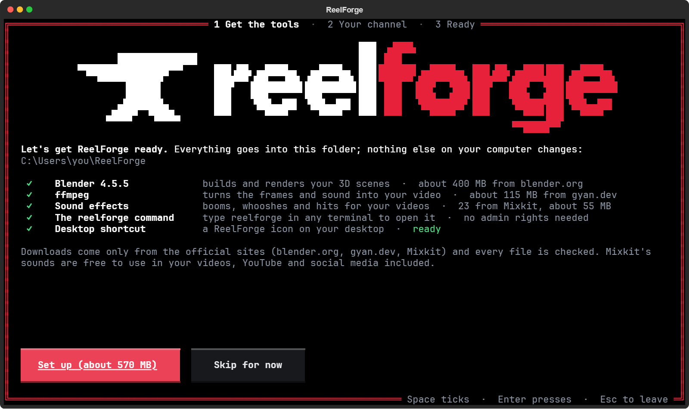
  
</p>

## Make your first video

First-time setup turns your answers into instructions for your AI, `CLAUDE.md` for Claude Code and `AGENTS.md` for Codex,
and saves them in the ReelForge folder (`C:\Users\<you>\ReelForge` on Windows and `~/ReelForge` on a Mac or Linux,
unless you picked another). Its last screen tells you what to do next.

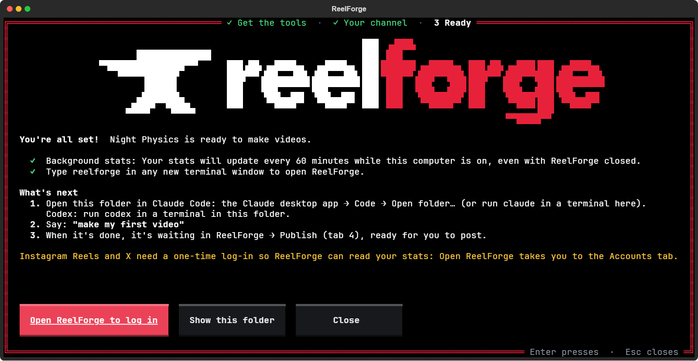

1. **Open the ReelForge folder in your AI.** In the Claude desktop app, go to **Code**, click **Open folder…** and
   pick the ReelForge folder (or run `claude` in a terminal inside it). For Codex, run `codex` in a terminal inside
   it.
2. **Tell it about your channel.** Drag a file about it into the chat (your notes, a doc, videos you like: whatever
   you have) or paste a description, and say:

   ```
   here's my channel
   ```

   First-time setup only asks a few questions, so this is where your AI gets the full picture. It keeps your words
   as the channel's brief (`my-studio/brief.md`), reads it every time and plans every video from it, and it asks
   before changing your answers to match. Skip this and it asks for one before your first video.
3. **Ask for your first video** in the words that screen gives you:

   ```
   make my first video
   ```

4. **Let it work.** Your AI picks a subject, writes the script, checks the facts, builds the scene in Blender and
   renders it, adds the text and the sound, then watches the finished video and fixes anything that's off. Rendering
   takes from about 15 minutes to an hour on a fast graphics card.
5. **Post it.** Open ReelForge (type `reelforge` in any terminal, or open the ReelForge icon: on your desktop on
   Windows, in Applications on a Mac, in your app menu on Linux) and click the green **Publish** button at the top
   right.

After that, say **make today's videos** whenever you want more, and give it a new file whenever your plans for the
channel change.

## Inside ReelForge

Seven tabs run along the top: Overview, Videos, Compare, Stats, Accounts, Settings and Updates, in any order you like
(pick it on the Settings tab). **Publish**, where your finished videos wait, is the green button at the top right.
Open any of them straight from a terminal by name, like `reelforge publish`, or a tab by where it sits, from
`reelforge 1` at the far left to `reelforge 7`. Everything works with the mouse or the keyboard: **1**-**7** open the
tabs in the order they're shown, **u** opens Publish, **r** refreshes your stats, **p** opens your profiles, **?** the
help, **Tab** moves between buttons and fields, **Enter** presses and **Esc** closes.

The window is calm and dark, so your numbers stand out: each platform keeps its own colour (TikTok cyan, YouTube red,
Instagram purple, X white), green and red show what went up and down, and amber marks where each video went up.
Numbers count up and charts grow in as they arrive, and the tabs slide. Under **↻ Refresh** at the top is when your
stats were last read (in amber while a read is under way), and if a platform's last read failed, the bottom left of
the window says so: click it for Accounts. It fits any window: in a small one the Overview's panels stack and scroll
instead of squeezing.
ReelForge's window and its first-time setup are built with [OpenTUI](https://github.com/anomalyco/opentui), and look
sharpest in Windows Terminal.

### Overview

A tile for each platform you've connected, and one for them all: your followers in big numbers, today's change,
your views and likes, and your views hour by hour (on All platforms, each platform's share). Under them, today's
badges, then the views, followers and likes you gained each hour (or each few hours, or day: pick 24H, 48H, 7D or
30D), stacked by platform, with a mark where each video went up. Hours your computer was off are filled in with an
estimate, hatched. Point at a bar to read its numbers, and click a platform's name to hide it. Beside the charts are
your top videos (with their views 12 hours in) and how the latest one is doing. The bell at the top right
collects milestones, new videos ready to post and updates, and shows how many are new on its shoulder. Click a
notification to see what it's about: a video that's taking off opens on the Videos tab, highlighted, and a finished
video is picked out on Publish. The × beside a notification deletes it, and Clear all deletes them all.

<p align="center">
  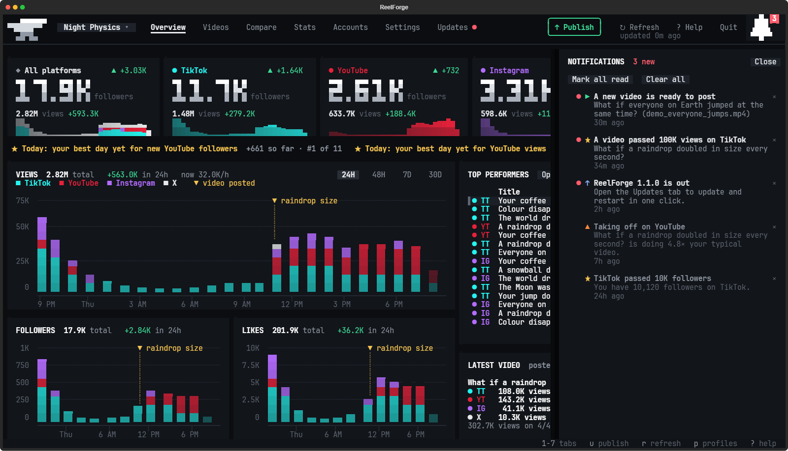
  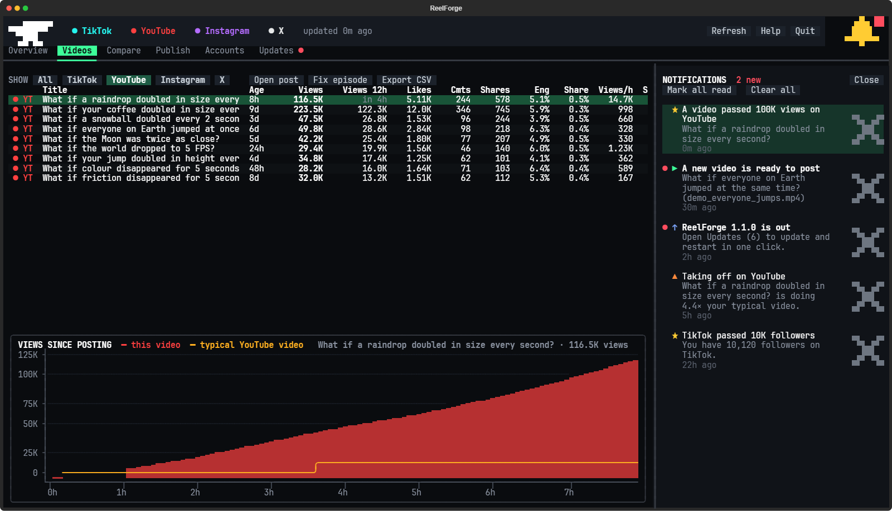
</p>

### Videos

Every video on every platform in one table, scored against your typical video, with its views 12 hours after it went
up, so new and old videos compare fairly. Click a header to sort, and pick a video to see how its views grew after you
posted it. Export CSV saves every video with when it went up (date, weekday, hour and UTC time) and its views 1, 6,
12 and 24 hours in.

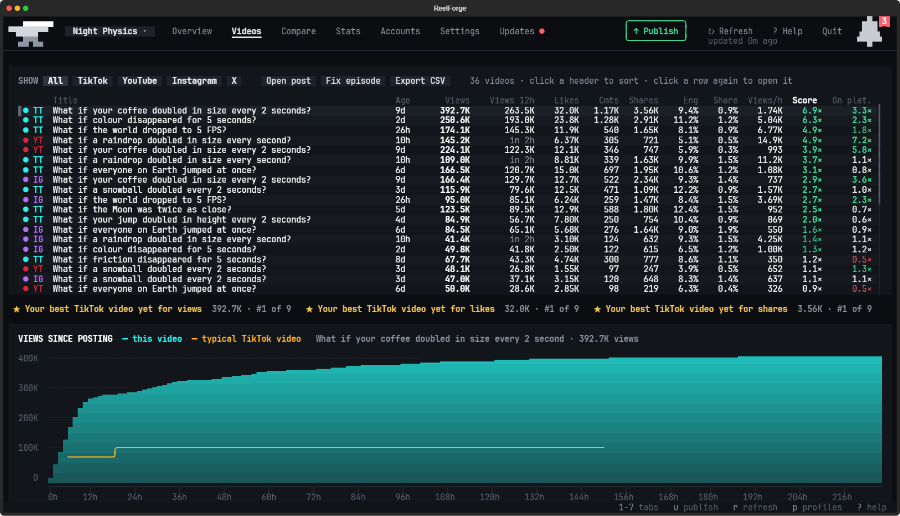

### Compare

Which platform is working for you: views per video, like rate and followers gained side by side, and how a typical
video grows over its first three days on each one. Pick an episode from the list (newest first, oldest first or most
views first) to see it on every platform against each one's typical video.

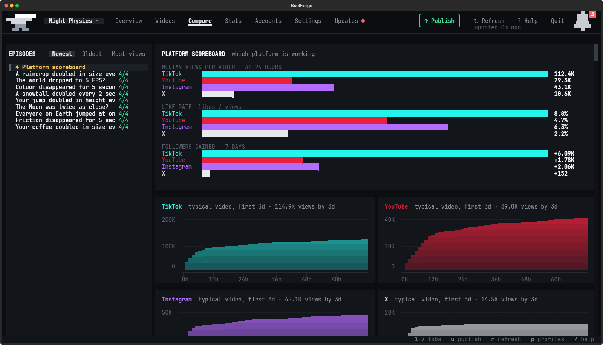

### Publish

Every finished video waits here with its post already written: click the green **Publish** button at the top right
(or press **u**), from any tab. Each platform's button opens that site's upload page, copies exactly the text it
needs and shows the video in Explorer, Finder or your file manager, so you drag it in and press Post. ReelForge spots
the post by itself.
Under the list, Best time to post shows the part of the day your videos have done best in on each platform, by
their views in their first day, and when it next comes round, once there are enough videos to tell.

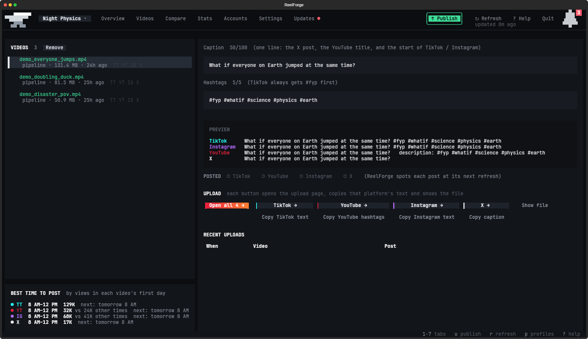

### Stats

Your views, followers and likes added up across your platforms, over time. **Add up** at the top ticks the platforms
the totals count: click one to leave it out, and again to bring it back. Pick 24H, 48H, 7D, 30D or ALL at the right.
Each chart draws the total from ReelForge's own readings, with a mark where each video went up. A stretch when your
computer was off is filled in with an estimate, the straight line between the readings either side, hatched so you can
tell it from a reading. Point at a chart to see the totals then, with each platform's part. Beside each
chart is every platform's number now, what it gained over the range, what it gained hour by hour (or day by day) and
its share of the total. `reelforge totals` opens it (`reelforge stats` is the hourly stats job).

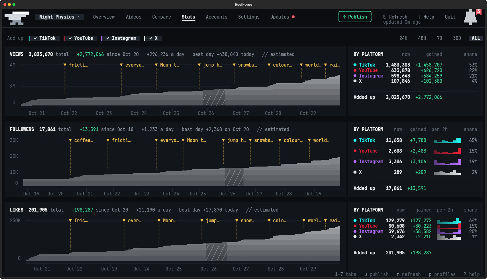

### Accounts

The platforms you post to, each connected with your @handle. ReelForge shows only the ones you've connected, so
there's never an empty card, chart or button for one you don't use. TikTok and YouTube need just your handle;
Instagram and X also need one log-in, in ReelForge's own browser window. There are no API keys to set up. No account
yet? Sign up opens the platform's own sign-up page with a few steps beside it (first-time setup offers the same, and a
new Gmail for your channel first). Disconnect hides a platform again without losing its stats.

<p align="center">
  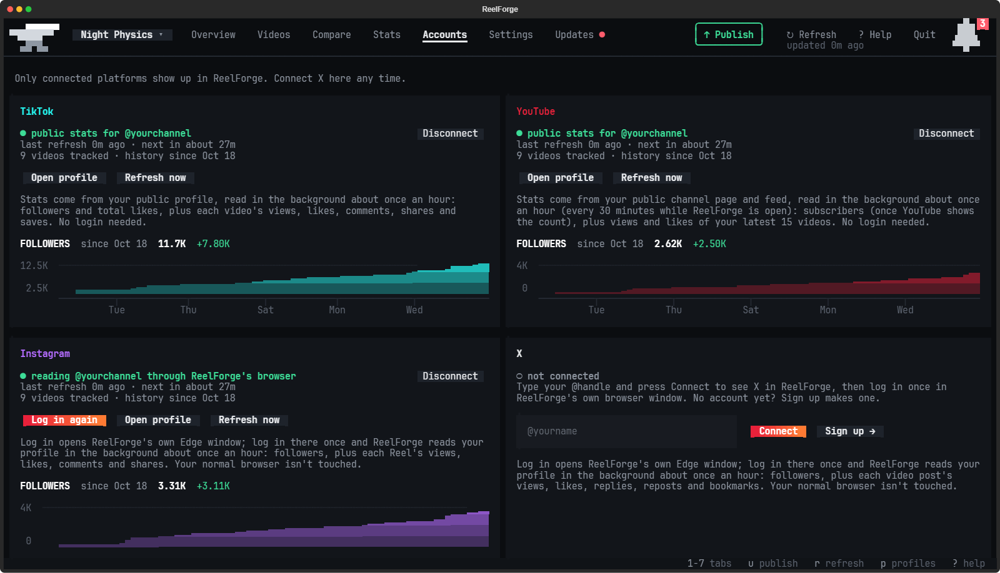
  
</p>

### Profiles

Run more than one channel from one ReelForge. Each channel is a profile, with its own accounts, logins, stats,
notifications, Publish list and settings. The button with your channel's name at the top left switches between them
(or press **p**), and a red dot on it means another profile has something unread. **New profile** asks the same short
questions as your first channel did, right in the window, and helps you make the new channel's accounts: a Gmail
first, then each platform's sign-up page, in a private window of your browser so your first channel stays logged in.
Your first channel stays in the ReelForge folder itself, and each one you add gets its own folder in `profiles`, with
its own notes for your AI. Tell your AI about a new channel the way you did the first: "here's <its name>" and a file
about it. The hourly stats job reads every profile, and `reelforge -p "Channel name"` opens ReelForge on one. "Make
today's videos" makes every channel's, except one you set to post **Only when I ask** (a channel you're only trying
out, say).

Done with a channel you added? **Delete** beside it in the menu (or the Delete key, or **Delete…** under **Profiles**
on the Settings tab) asks you to type its name, then takes it out of ReelForge. Nothing is deleted for good: its whole
folder, with its accounts, logins, stats, settings and videos, moves into `backups` in the ReelForge folder, and
**Restore** on the Settings tab puts it back as it was. ReelForge never deletes the profile the window is showing
(switch to another one first), one open in another ReelForge window, or your first channel, which is the ReelForge
folder itself.

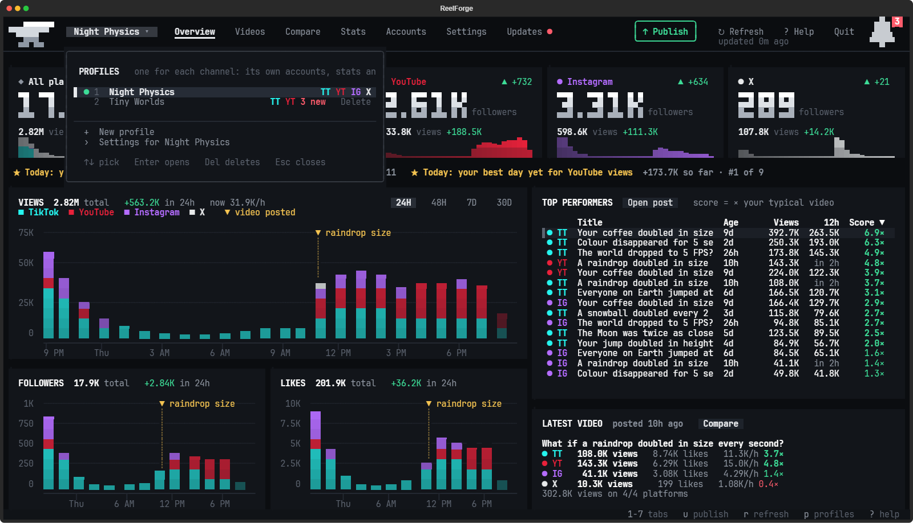

### Settings

This channel's answers from first-time setup (**Change your answers** asks the questions again), an FAQ beside them
(click a question and its answer opens under it), and what ReelForge set up on your computer: **Background refresh**,
the hourly stats read that keeps your stats updating while ReelForge is closed, with a switch to turn it on or off,
then the `reelforge` command and the icon, each with a button. **Restart** under them closes ReelForge and opens it
again straight away. Then **Profiles** lists your channels, with **Delete…** beside each one you can delete and
**New profile**, then the ones you've deleted, each with **Restore** and **Move to the Recycle Bin** (to free its space
for good). Across the bottom, the danger zone: **Factory reset** puts every channel's settings, logins and stats in a
backup and starts first-time setup again, and **Uninstall** removes ReelForge. Both ask you to type your channel's
name first, and neither deletes anything: what they clear goes to a backup or the Recycle Bin (the Trash on a Mac).
Neither stops half-way either: if something can't be moved (another ReelForge window has it open, say), nothing
changes.

**Tab order**, under the FAQ, puts the tabs along the top in the order you like: drag a tab where you want it, or
click one and move it with **← Move left** and **Move right →** (or Shift and the arrow keys). The number keys follow
the new order, and so does `reelforge 1` to `reelforge 7`. It's kept for every channel, and **Reset to default** puts
them back as they started, with Settings and Updates at the far right. Publish isn't one of them: it keeps its own
green button at the top right.

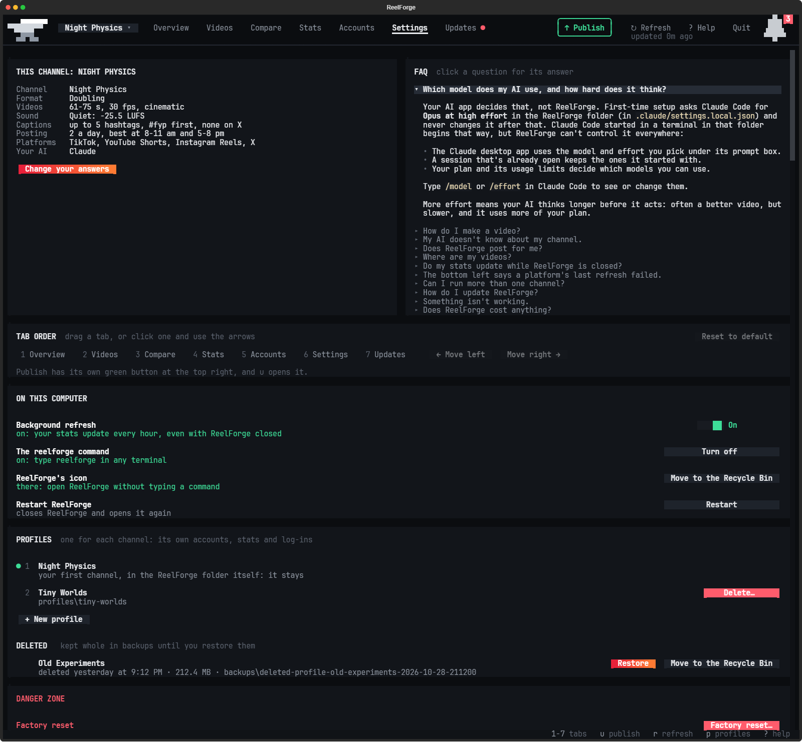

## Updates

When a new version is out, the bell tells you, and the **Updates** tab (`reelforge updates`) gets a red dot and shows
what's new. Click **Update and restart** to install it: the anvil hammers while it installs and hops once it's in.
Your channel, videos, stats and settings stay as they are, and your AI's instructions are refreshed for the new
version.

<p align="center">
  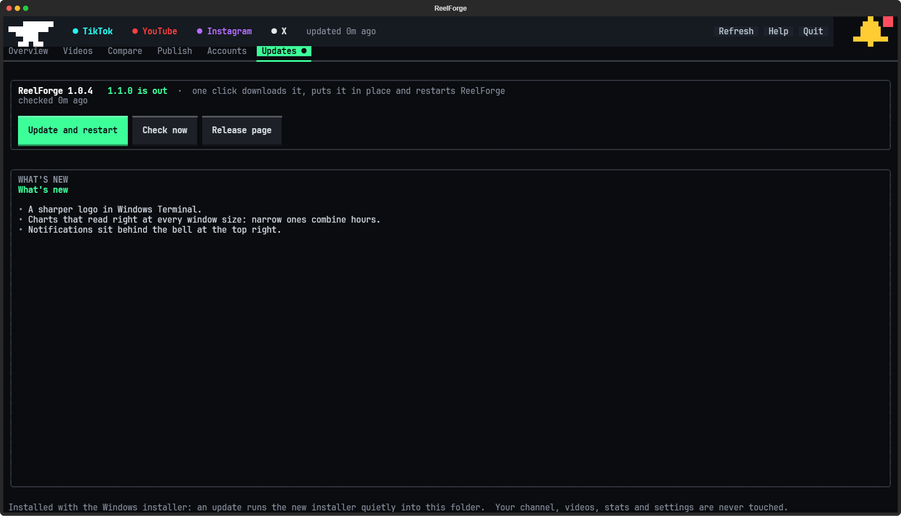
</p>

## FAQ

<details>
<summary><b>Is the install line safe to paste?</b></summary>

<br>

Yes. It runs a short script from this repository's latest release, [install.ps1](scripts/install.ps1) on Windows
and [install.sh](scripts/install.sh) on a Mac or Linux, so you can read it first. The script downloads ReelForge from
the same release, checks it against the release's checksums, unpacks it into your user folder and starts setup. It
doesn't need admin rights. Copy the line only from this page or [reelforge.tools](https://reelforge.tools).

</details>

<details>
<summary><b>Is ReelForge free?</b></summary>

<br>

Yes. ReelForge is free and open source. Making videos uses your own Claude Code or Codex plan.

</details>

<details>
<summary><b>Does it post for me?</b></summary>

<br>

No. ReelForge never posts, uploads or sends anything. Finished videos wait in Publish (the green button at the top
of ReelForge), and you post them yourself.

</details>

<details>
<summary><b>Can I install it somewhere else?</b></summary>

<br>

Yes, on any drive with room for your videos. On Windows, run this in the same PowerShell window before you paste
the install line, with your own folder:

```powershell
$env:REELFORGE_DIR = "D:\ReelForge"
```

On a Mac or Linux, put the folder in the install line, before `bash`:

```
curl -fsSL https://github.com/dan2756/ReelForge/releases/latest/download/install.sh | REELFORGE_DIR=/Volumes/Big/ReelForge bash
```

</details>

<details>
<summary><b>Where are my videos?</b></summary>

<br>

In Publish (the green button at the top of ReelForge), and as files in the ReelForge folder: every video has its own
folder in `episodes`, and a copy of each finished one goes to `completed videos`.

</details>

<details>
<summary><b>Do my stats update while ReelForge is closed?</b></summary>

<br>

Yes, if you said yes during first-time setup. Once an hour, while your computer is on, a small background job reads your
stats for about a minute, then stops. Turn it off or back on with the **Background refresh** switch on the Settings
tab, or with `reelforge stats off` and `reelforge stats on`.

</details>

<details>
<summary><b>Can I have ReelForge open in more than one window?</b></summary>

<br>

Yes, as many as you like, say one on the Overview and one on Publish, or one for each of your channels. Windows on
the same channel take turns reading its stats, and as soon as one of them has read them, every window shows the new
numbers and notifications, so they always agree and your accounts are read only once. The hourly background job's
reads show up in them too.

</details>

<details>
<summary><b>Can I run more than one channel?</b></summary>

<br>

Yes. Add a profile for each one: click the button with your channel's name at the top left, then **New profile** (or
run `reelforge profiles new`). It asks the same questions as your first channel did and helps you make the new
channel's accounts. Its accounts, logins, stats, notifications and settings are its own. Your AI works on all of them
from the ReelForge folder: say which channel a video is for, like "make a video for Cool Epic Facts". Each channel's
notes are in its folder (`profiles/<name>/CLAUDE.md`), and the main `CLAUDE.md` lists them.

</details>

<details>
<summary><b>How do I delete a channel I added?</b></summary>

<br>

Open the profile menu (click your channel's name at the top left, or press **p**), then click **Delete** beside it
(or pick it and press the Delete key). It's under **Profiles** on the Settings tab too. Type its name to confirm. Its
whole folder moves into `backups` in the ReelForge folder, so nothing is lost: **Restore** beside it on the Settings
tab puts it back as it was, and **Move to the Recycle Bin** there frees its space once you're sure. You can't delete
the channel the window is showing (switch to another one first) or your first channel, which is the ReelForge folder
itself. From a terminal: `reelforge profiles delete "Channel name"` and `reelforge profiles restore "Channel name"`.

</details>

<details>
<summary><b>My AI doesn't know about my channel.</b></summary>

<br>

Make sure you opened the ReelForge folder itself, not the folder it's in: your AI reads `CLAUDE.md` (or `AGENTS.md`)
from there. First-time setup only asks a few questions, so give it the full picture too: drag a file about your
channel into the chat (or paste a description) and say "here's my channel". It keeps it as the channel's brief and
plans every video from it. To change your answers, run `reelforge channel`.

</details>

<details>
<summary><b>How do I change my answers?</b></summary>

<br>

Run `reelforge channel`. It starts from your last answers, and when you finish it rewrites your AI's instructions and
ReelForge's settings. For another channel, open the profile menu and pick its settings, or run
`reelforge -p "Channel name" channel`.

</details>

<details>
<summary><b>Which model does my AI use, and how hard does it think?</b></summary>

<br>

Your AI app decides that, not ReelForge. First-time setup asks Claude Code for Opus at high effort in the ReelForge
folder (in `.claude/settings.local.json`) and never changes it after that. Claude Code started in a terminal in that
folder begins that way, but ReelForge can't control it everywhere:

- The Claude desktop app uses the model and effort you pick under its prompt box.
- A session that's already open keeps the ones it started with.
- Your plan and its usage limits decide which models you can use.

Type `/model` or `/effort` in Claude Code to see or change them. With Codex, ReelForge's `.codex/config.toml` asks
for high reasoning once you trust the folder as a project, and `/model` picks the model and how hard it reasons.

More effort means your AI thinks longer before it acts: often a better video, but slower, and it uses more of your
plan. The **Settings** tab's FAQ says the same, along with answers to other questions.

</details>

<details>
<summary><b>Can I try things in a second copy without touching my real one?</b></summary>

<br>

Yes. Install a second copy into a folder of its own, without setting it up yet. On Windows, run this in PowerShell
before you paste the install line, with your own folder:

```powershell
$env:REELFORGE_DIR = "D:\ReelForge Test"; $env:REELFORGE_NO_SETUP = "1"
```

On a Mac or Linux, put them in the install line, before `bash`:

```
curl -fsSL https://github.com/dan2756/ReelForge/releases/latest/download/install.sh | REELFORGE_DIR=~/ReelForge-Test REELFORGE_NO_SETUP=1 bash
```

Then put a file called `TEST-COPY.txt` in that folder and set it up with its `setup.bat` (Windows) or `./setup.sh`.
That copy's window says **TEST**, its stats, logins and settings are its own, and it never touches the `reelforge`
command, the hourly stats job or ReelForge's icon, which stay with your real ReelForge. Open it with its own
`ReelForge.bat` (Windows) or `./reelforge.sh` (Mac and Linux).

</details>

<details>
<summary><b>Something isn't working.</b></summary>

<br>

Try **Restart** on the Settings tab first: ReelForge closes and opens again. If that doesn't fix it, run
`reelforge doctor`. It checks everything ReelForge needs and says how to fix anything that fails. `reelforge setup`
repairs the setup.

</details>

<details>
<summary><b>Does it work the same on a Mac or Linux?</b></summary>

<br>

Yes. Setup gets everything ReelForge needs into its own folder on all three, so you don't need Homebrew or a package
manager: Blender from blender.org, ffmpeg from the builds ffmpeg.org points to, Bun (for ReelForge's window) from its
own releases, and a private Python if yours is older than 3.11. ReelForge reads your stats with Chrome or Edge if you have one, or with a Chromium setup downloads if you
don't. On a Mac, ReelForge goes in your Applications folder (so it's in Launchpad, Spotlight and the Dock) and opens in
Terminal; on Linux it goes in your app menu. The hourly stats job is a launchd agent on a Mac and a systemd timer (or
a cron job) on Linux. Every change is tested on Windows, on Macs with Apple Silicon and Intel, and on Linux.

blender.org has no Blender for ARM Linux, so on an ARM Linux PC install Blender 4.5 yourself (then setup finds it)
or point `STUDIO_BLENDER` at it.

</details>

<details>
<summary><b>Which commands are there?</b></summary>

<br>

- `reelforge` opens ReelForge.
- `reelforge publish`, `reelforge videos` and so on open a tab by name, and `reelforge 1` to `reelforge 7` by where
  it sits along the top (1 is the far left; Publish, the green button, goes by its name).
- `reelforge channel` changes your channel answers.
- `reelforge profiles` lists your channels, and `reelforge profiles new` adds one.
- `reelforge profiles delete "Channel name"` deletes one you added (it's kept in `backups`), and
  `reelforge profiles restore` brings it back.
- `reelforge -p "Channel name"` opens ReelForge on one channel (it works with any command).
- `reelforge setup` sets up or repairs the tools.
- `reelforge doctor` checks everything. `--render-test` also builds an example scene and renders one frame.
  `reelforge doctor --json` writes one JSON document to stdout with `version`, `root`, `failed`, and `checks`
  (`status`, `what`, and `detail` for each check). Status values are `ok`, `warn`, and `FAIL`.
  With `--render-test --json`, progress goes to stderr. Both formats exit with code 1 if any check fails, or 0 otherwise.
- `reelforge stats on` and `reelforge stats off` turn the hourly stats on and off.
- `reelforge reset` starts over (a factory reset), and `reelforge uninstall` removes ReelForge.
- `reelforge help` lists the rest.

</details>

<details>
<summary><b>How do I uninstall it?</b></summary>

<br>

Run `reelforge uninstall`, or click **Uninstall…** at the bottom of the **Settings** tab. It lists what it removes and
asks you to type your channel's name, then:

- moves your videos and each channel's answers to **ReelForge videos and channels**, a folder beside ReelForge's
  (add `--remove-videos` to let them go with the rest). If one can't be moved, it stops there and nothing changes.
- turns off the hourly stats read and the `reelforge` command, and puts ReelForge's icon (and on Windows its Windows
  Terminal profile) in the Recycle Bin or the Trash
- puts the ReelForge folder in the Recycle Bin or the Trash: the app, Blender, ffmpeg, Bun, your stats, logins and
  settings. On Windows a small window does this once ReelForge has closed, and says when it's done. Restore it from
  the bin if you change your mind, or empty the bin to get the space back.

Nothing is deleted for good, and videos kept outside the ReelForge folder aren't touched.

</details>

<details>
<summary><b>How do I start over?</b></summary>

<br>

Run `reelforge reset`, or click **Factory reset…** on the **Settings** tab. It moves every channel's settings, logins
and stats into a backup in `backups` and starts first-time setup again. Your videos stay where they are, and so do
Blender, ffmpeg and the sounds, so nothing is downloaded again. If you have more than one channel, the others go into
the backup whole, videos included. If something can't be moved (another ReelForge window has it open, say), nothing
changes. To undo a reset, move the backup's files back.

</details>

## License

ReelForge is free and open source under the [MIT license](LICENSE). Setup downloads Blender and ffmpeg from their
official sites, Bun from its GitHub releases (with the window's OpenTUI packages from npm) and the Mixkit sound
effects from Mixkit; the Kenney sound effects come with it. Details are in [THIRD_PARTY.md](THIRD_PARTY.md).
