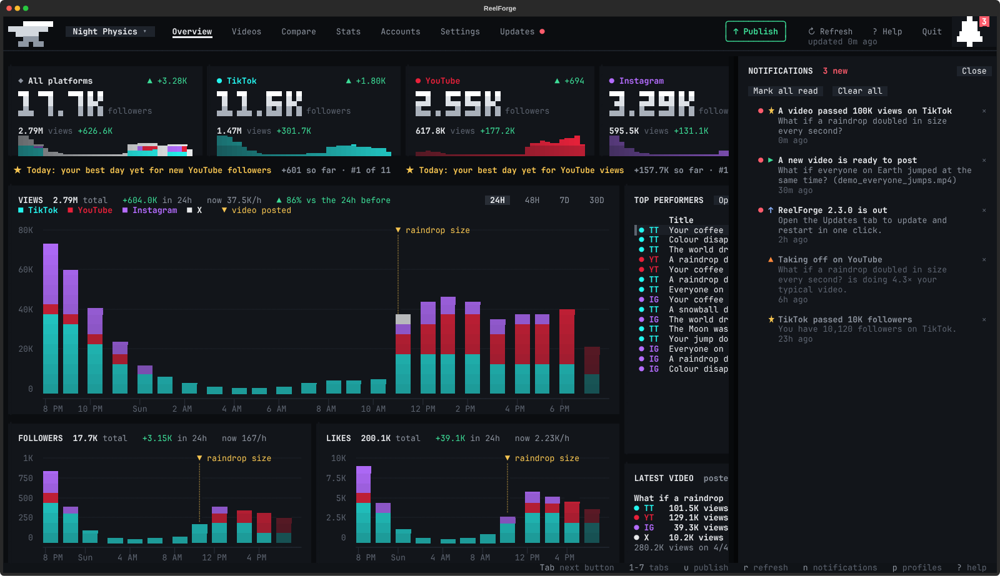
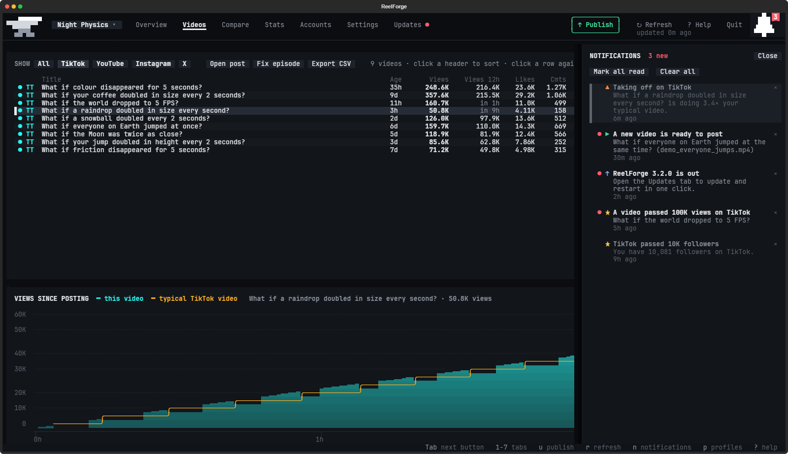
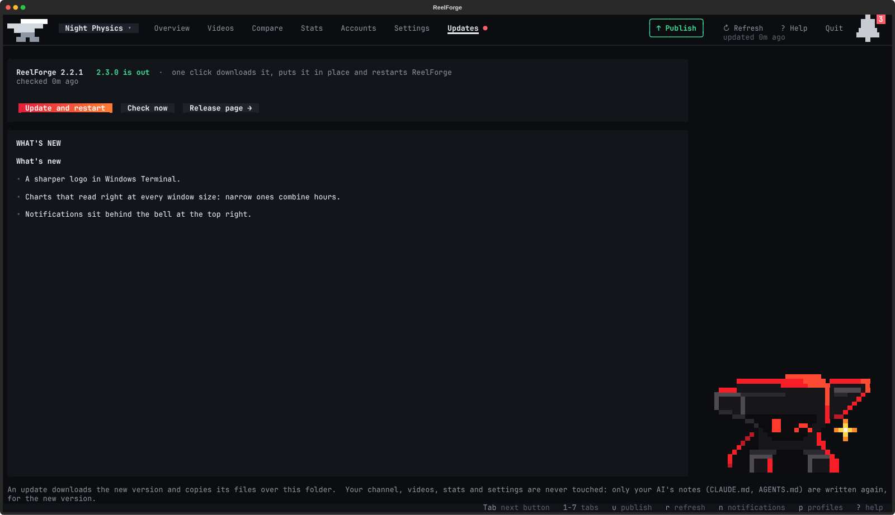
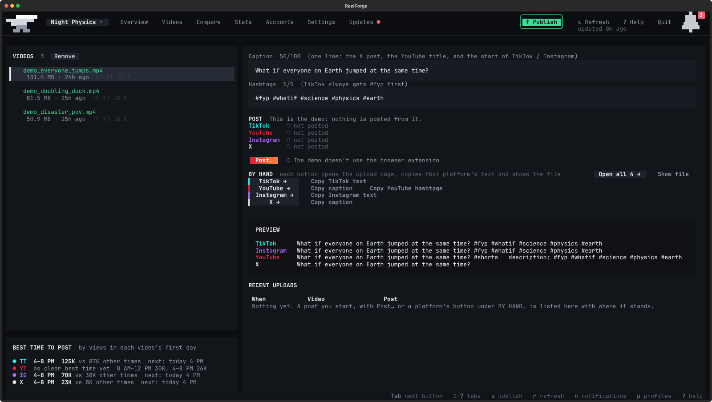

# The ReelForge window

This is what opens when you type `reelforge` in a terminal (or use the ReelForge shortcut): your stats on TikTok,
YouTube, Instagram and X, the **Publish** tab where every finished video waits for you to post it, a notifications
drawer, and one-click updates. Nothing is posted without your press: you post from Publish by hand, with the
optional browser extension, or for YouTube through its own API (see [Publish](#publish) below).



## Opening it

| Type this | and you get |
|---|---|
| `reelforge` | the Overview |
| `reelforge 1` … `reelforge 7` | straight to the tab in that place along the top, 1 at the far left: by default 1 Overview, 2 Videos, 3 Compare, 4 Stats, 5 Accounts, 6 Settings, 7 Updates (the Settings tab's **Tab order** changes it) |
| `reelforge videos`, `reelforge publish`, … | the same, by the tab's name (`post` and `upload` work for Publish, which is the green button at the top right and has no number, `login` for Accounts, `totals` for Stats: `reelforge stats` is the hourly job) |
| `reelforge notifications` | the Overview with the notifications drawer open |
| `reelforge -p "Channel name"` | ReelForge on one of your profiles (its number in the list, the start of its name, or its folder, like `profiles/cool-epic-facts`, works too; the commands ReelForge writes out for you name it by its folder, in double quotes when you've renamed the folder with a space in it, say, and in single quotes when its name has a `$`, a backtick, a `"` or a backslash in it, or on a Mac or Linux a `!` (an episode's folder in your AI's notes, and in the command `new-episode` gives next, goes in the same quotes, so `make_episode.py "profiles/sea facts - Copy/episodes/<id>"` stays one word); on Windows, where `reelforge` changes a `!` or a `%NAME%` whatever its quotes, your AI's notes run ReelForge's Python straight for such a folder, `.venv\Scripts\python -m studio -p ...`, from the ReelForge folder; a command it prints for you to run there and then names it by its number instead when the folder's name has a character no quotes keep as it is in every shell, like `$`, `%` or `!`, but your AI's notes never do, as that number changes when you add or delete a channel) |
| `reelforge --demo` | a tour on made-up numbers: nothing is read or saved |

ReelForge shows only the platforms you've connected: first-time setup connects the ones you give it a handle for, and
**Accounts** connects (or disconnects) any of them later. TikTok and YouTube stats start straight away; Instagram
and X need **Log in** once (see below). With nothing connected yet, ReelForge opens on Accounts. It looks best in
Windows Terminal with the window maximised, and is drawn for 80 columns by 24 rows and up: in a smaller window a
tab that doesn't fit scrolls, Refresh, Help and Quit are the signs ↻ ? × at the top, and on Publish the videos go
above the form.
Everything is a button on the page it applies to, for the mouse or the keyboard: **1**-**7** open the tabs in the
order they're shown, **u** opens Publish (the green button at the top right), **r** / **R** refresh / force a
refresh, **n** opens and closes the notifications, **p** opens the profile menu, **Tab** moves between buttons,
lists and fields (**Enter** presses, the arrows move through a list) and scrolls what it lands on into view,
**Page Up** and **Page Down** scroll a tab or a dialog that is longer than the window, **Esc** closes the drawer or
a dialog or leaves a text field, and **Ctrl+Q** quits. A few things are still for the mouse only: the chips on a
line (a chart's ranges, Show on Videos, Remove, Disconnect, Mark all read) and a table's headings.

The window is an [OpenTUI](https://github.com/anomalyco/opentui) app (`ui/` in the ReelForge folder), run by Bun; setup
puts Bun in `tools/bun` and the window's packages in `ui/node_modules`, and ReelForge gets them again by itself if
they're ever missing (an update that needs new ones, say).

## Profiles

A profile is one channel, with its own accounts, logins (its own browser profile), stats, notifications, Publish list
and settings. The button with the channel's name next to the anvil shows which one the window has open; click it (or
press **p**) for the menu:

| In the menu | |
|---|---|
| a profile | shows it in this window, on the tab you're on (each profile's row has its connected platforms and its unread notifications) |
| **New profile** | first-time setup for a new channel, inside the window: your name and your AI carry over, and so does your answer to the hourly stats read (No when the profile you're on says no to it, in its answers or in its `studio.toml`), the channel's other answers start fresh, and it opens on the new profile's Accounts tab |
| **Settings for …** | the channel's questions again, for the profile you're on |
| **Delete** (or the Delete key) | takes another profile out of ReelForge once you type its name: its folder moves whole into `backups/` |

**Deleting a profile** never deletes anything: its folder (accounts, logins, stats, notifications, settings, your AI's
notes and its videos) moves whole into `backups/deleted-profile-<name>-<date>/` in the ReelForge folder, and the
Settings tab's **Profiles** panel lists it with **Restore**, which puts it back as it was, and **Move to the Recycle
Bin** (Trash), which frees its space for good. Delete is there too, beside each profile. A window can't delete its own
profile (switch to another one first) or the first one, which is the ReelForge folder itself, and no window deletes a
profile another window is showing or whose stats are being read. `reelforge profiles delete NAME` and
`reelforge profiles restore NAME` do the same from a terminal.

A red dot on the button means another profile has unread notifications. ReelForge opens on the profile you had open
last. The first profile is the ReelForge folder's own (`my-studio/`, `dashboard/config.toml`, `dashboard/data/`, as
always); each one you add gets a folder in `profiles/`, laid out the same way: `profiles/<name>/my-studio/`,
`profiles/<name>/dashboard/config.toml` and `profiles/<name>/dashboard/data/`, its episodes and finished videos, and its
own `CLAUDE.md` and `AGENTS.md`. The hourly background job reads every profile, each in turn (a profile whose first-time
setup said no to background stats, or whose `my-studio/studio.toml` says `background_stats = false`, is read only while
it's open; writing its files again from its answers, `reelforge -p <profile> channel --regenerate`, keeps that no, and
its questions, in its Settings in the profile menu or `reelforge -p <profile> channel`, start from it, as does that
question for a new profile made from it (**New profile** while it's open): a yes is yours to give there. A
`background_stats = true` written in that file against its answers' no doesn't turn the read on either: writing its
files again puts the no back, says so, and leaves the yes in the copy of the file it keeps in `my-studio/backups/`).
While that `studio.toml` has a mistake in it (saved in Notepad as Unicode is one: save it as UTF-8), the job goes by the
file's own `background_stats` lines, wherever they are and however they're written (`Background-Stats`,
`background stats`, `background_stat`, with `=` or a colon, as `answers.json` has it), and only a yes there is a yes;
words in a text setting or a comment are never taken for one. A text is one whose quotes are closed, on its own line or,
for one of several lines (`"""` or `'''`), on any line below; a quote left open, often the very mistake, hides nothing,
so a `background_stats` line after it, on its line or below, still counts.

## Several windows

You can have ReelForge open in several windows at once, each on its own tab (the Overview in one, Publish in
another), or each on its own profile. Windows on the same profile share one set of stats: one window reads them at a
time, with **refreshing …** under every window's **↻ Refresh** meanwhile, and as soon as it's done every window shows
the new numbers, notifications and errors. The hourly background job's reads show up the same way. **r** in a window
while another one is reading waits for that read instead of reading everything again. Switching a window to another
profile lets a read it has under way finish first, in the background, into its own profile.

On Windows, ReelForge also adds itself to Windows Terminal: opened from the desktop shortcut or the Start menu, its
tab is called ReelForge and shows the anvil, and **ReelForge** is in Terminal's **+** menu. Terminal picks this up the
next time it starts. A tab you type `reelforge` into is called ReelForge too, but keeps that tab's own icon.

## The tabs, and Publish

Seven tabs sit along the top in the order below until you change it. **Publish**, in the table with them, isn't one
of them: it's the green button at the top right (**u** opens it too), whatever the order, so it has no number. The
Settings tab's **Tab order** puts the tabs in any order you like (drag a tab, or click one and use **← Move left** and
**Move right →**), for every profile at once: **1**-**7** and `reelforge 1` … `reelforge 7` follow it, and **Reset
to default** puts it back. It's kept in `dashboard/data/tab-order.json` (an order kept before Publish had its button
just leaves Publish out).

| Tab | What's on it |
|---|---|
| **Overview** | A tile per platform (and all of them added up): followers in big numbers, views, likes, the change over 24 hours and views per hour (on All platforms, each platform's share). Under the tiles, today's **badges** (below). Then **views**, **followers** and **likes** gained over time, stacked by platform: each bar is the shortest stretch the window has room for (an hour on 24H when it's wide enough, a few hours or a day on the longer ranges), with yellow ▼ marks where each video went up (hours the computer was off are filled in with an estimate, what the readings either side gained shared out evenly, hatched ╱╱ on top of what was read; an estimate is never the best bar), your **top performers** (with their views 12 hours in) and how your **latest video** is doing. |
| **Videos** | Every video on every platform: views, **views 12 hours in** (so new and old videos compare fairly; "in 5h" until a video is that old, — when the computer was off then), likes, comments, shares, engagement, share rate, views per hour and score. Click a header to sort. Above the chart, the highlighted video's **badges**. **Fix episode** if a post was grouped with the wrong video; **Export CSV** saves everything as a spreadsheet, with when each post went up (date, weekday, hour and UTC time) and its views 1, 6, 12 and 24 hours in. |
| **Compare** | The **platform scoreboard**, or one video side by side on every platform against that platform's typical video. **Newest**, **Oldest** and **Most views** beside the episodes sort them (most views: each one's views on every platform added up). |
| **Publish** | Finished videos, newest first, with the platforms each one is already on. Pick one and check the caption and hashtags (the preview shows exactly what each platform gets). **POST** has a row for each platform that says where its post stands, and **Post…**, for the browser extension. **BY HAND** has each platform's own button. Under the list, the **best time to post** on each platform. See [Publish](#publish) below. |
| **Stats** | Your **views**, **followers** and **likes** added up across your platforms, over time. **Add up** ticks the platforms the totals count (click one to leave it out, and again to count it); the range is 24H, 48H, 7D, 30D or ALL. Each chart is the total as a filled area from ReelForge's readings: a stretch the computer was off for is filled in with an estimate, the straight line between the readings either side, hatched ╱╱ and marked estimated when you point at it (a platform whose log-in ran out for a while is estimated the same way, and the total is hatched where that platform is most of it); an estimate is never a best day or hour. A platform whose reads stopped counts with its last reading (its row says when that was), and the totals start once every platform counted has its first reading. Point at a chart for the totals then and each platform's part; yellow ▼ marks show where videos went up. Beside each chart, every platform's number now, its gain over the range, its gains hour by hour (or day by day) and its share of the total. |
| **Accounts** | Every platform: **Connect** one with your @handle (or **Sign up** for one you don't have yet: it opens the platform's own sign-up page, with the steps beside it, in a private window of your browser once you have more than one profile) and **Disconnect** one you've stopped using (its stats stay saved). For a connected one: where its stats come from, when they were last and will next be read, the last error if any, **Log in** (Instagram, X), **Open profile** and **Refresh now**. |
| **Settings** | This channel's answers from first-time setup (**Change your answers**), an **FAQ** (click a question for its answer; the first says which model your AI uses and how hard it thinks, which your AI app decides, not ReelForge), the **Tab order** (above), what ReelForge set up on this computer (**Background refresh**, the hourly stats read, with a switch to turn it on or off; the `reelforge` command and the icon, each with its button), **Restart** (ReelForge closes and opens again straight away), and your **Profiles**: **Delete…** beside each one this window can delete, **New profile**, and the deleted ones, each with **Restore** (see Profiles above). At the bottom, **Factory reset** (every channel's settings, logins and stats into a backup in `backups`, then first-time setup again; videos stay) and **Uninstall** (videos and channels kept in a folder beside ReelForge, the rest to the Recycle Bin or the Trash). Both ask for the channel's name; `reelforge reset` and `reelforge uninstall` do the same. |
| **Updates** | Your version, what's new in the next one (or in yours, when it's the newest), and **Update and restart**. |

**Score** is how a video compares with your typical video at the same age, across every platform: 1.0× is normal and
3× is a hit. **Engagement** = (likes + comments + shares) ÷ views. **Share rate** = shares ÷ views, the strongest
sign a video is spreading.

## Notifications

The **bell** in the top-right corner (or **n**) opens the drawer on the right; the bell, **n**, **Close** or Esc
closes it. The number on the bell's shoulder is how many are unread; **Mark all read** clears
it. The **×** beside a notification deletes it (Delete does the same for the highlighted one), and **Clear
all** deletes every one. Click a notification to see what it's about, from any tab (the drawer stays open, so you
can go through them):

| You hear about | Clicking it shows |
|---|---|
| a video **taking off** (3× your typical one in its first 12 hours), passing 1K, 10K, 100K, 1M … **views**, or moving up to a better **badge** | the **Videos** tab with that platform's videos, the video highlighted (scrolled to if it's far down) and its chart underneath |
| a **finished video** that's ready to post | the **Publish** tab with that video picked, its caption and hashtags filled in |
| a platform passing 100, 500, 1K, 5K, 10K, 25K, 50K, 100K … **followers** | that platform's panel on **Accounts**, lit along its left edge for a few seconds |
| Instagram or X **logging ReelForge out** | that platform's panel on **Accounts**, with **Log in again** ready to press |
| **today's badge** on a platform, or your **views across every platform** passing 1K, 10K, 100K, 1M … | that platform's tile (or **All platforms**) on the **Overview**, lit along its left edge |
| a **new version** of ReelForge (once per version), or ReelForge having **updated** | the **Updates** tab, with what's new |



With the hourly background job on (first-time setup asks; `reelforge stats on`), ReelForge reads your stats while it's
closed too, so the drawer has news waiting when you open it. Nothing is told twice, so one you deleted stays
deleted, and the first look at a new account only takes stock: old milestones are never announced as new.

## Badges

"Top 5% of your TikTok videos for views", "Today: your best day yet for new YouTube followers". Badges compare you
with **yourself**, from the numbers ReelForge has stored, so they're always true:

- a video against your other videos on the same platform, for views, likes, shares and views in its first day (its
  reading 23-26 hours after it went up);
- today so far against your earlier days, for new followers and views on each platform (days ReelForge was only
  partly reading are left out).

Percentages (top 25%, 10%, 5%, 1%) need at least 10 videos or days to compare; before that a badge only says "your
best … yet", and only when it really is. Ties count against you. Moving up a tier adds a notification. Point at the
badges on either tab for a short reminder of all this.

There are no "top X% of all creators" badges: no platform publishes how big its creators' accounts are, and no
outside study can back such a claim yet (`badges.py` lists the ones checked).

## Updates

The **Updates** tab checks for a new version when ReelForge opens (every few hours at most; the background job
checks too, so the bell tells you). **Update and restart** downloads it, puts it in place and opens ReelForge again:




- installed with the install line (or from a download, or with the old Windows installer): the new version's files
  are copied over the old ones;
- a git copy: `git pull` (only when you haven't changed files yourself).

Your channel (`my-studio/`), videos (`episodes/`, `completed videos/`), stats, logins, settings and downloaded tools
are never touched, and your `CLAUDE.md` / `AGENTS.md` are written again from your settings as they are, with the new
version's instructions. If the download or its check fails, nothing has changed and the version you have keeps
working. If the update stops later (a file another program has open, say), the message says what to do: usually
**Update and restart** again, which carries on from where it stopped. From a terminal:
`.venv\Scripts\python -m studio.update` (add `--apply` to install).

## How ReelForge reads your stats

| Platform | How | What you get |
|---|---|---|
| TikTok | your public profile, in a background browser (no login) | followers, total likes, and each video's views, likes, comments, shares and saves |
| YouTube | your public channel page and feed | subscribers (once YouTube shows the count), and views and likes of your latest videos |
| Instagram | **log in once** (Accounts tab) | followers, and each Reel's views, likes, comments and shares |
| X | **log in once** (Accounts tab) | followers, and each video post's views, likes, replies, reposts and bookmarks |

**Log in** opens a window of ReelForge's own browser, with its own profile in `dashboard/data/browser`, separate
from your normal browsing. ReelForge uses Edge on Windows and Chrome on macOS and Linux (or Edge, or a Chromium setup
downloads when there's neither), and keeps using the one it started with. Log in there once and ReelForge closes it
and carries on; after that it opens your profile in the
background about once an hour and reads the numbers the page shows you. It never posts, likes or follows anything.
These are the same pages a browser loads, so a site redesign can break a reader until ReelForge is updated. If a
login ever stops working, **Type in stats** (on that platform's Accounts panel) opens TYPE IN STATS, a box to type
numbers in by hand. Once ReelForge reads the platform itself again, the numbers you typed become that post's history
for the time it couldn't. A number lower than the one saved before is not stored straight away: Save says so, and
replaces the saved one only when you press Save again.

Platforms report lifetime totals, so ReelForge saves a snapshot every time it reads them and builds the charts from
those snapshots: they fill in the longer it runs. **Background stats** (the Settings tab's **Background refresh**
switch, `reelforge stats on`, or first-time setup's question) keep them filling in while ReelForge is closed: a small
job wakes once an hour, reads your stats in a hidden browser for about a minute, and exits. The switch, or
`reelforge stats off`, stops it. Each run adds a line to `dashboard/data/refresh.log`.

## Publish

The green **Publish** button at the top right opens it, from any tab (so does **u**, and `reelforge publish`). It
lists every finished video from the pipeline (`episodes/<id>/final/<id>.mp4` and `completed videos/`), plus any
video you drop into `dashboard/videos/`. Picking one fills in the caption (the episode's `title`) and its hashtags.
What each platform gets follows your channel's caption rules from first-time setup: the caption plus hashtags on TikTok
(your first hashtag, usually #fyp, always leads) and Instagram, the caption with #shorts after it as the YouTube title
(**Copy caption** under YouTube's button) with the hashtags as its description, and the caption alone on X unless you
allowed hashtags there.



Under the caption and hashtags, **POST** has the picked video's review line and a row for each connected platform
that says where its post stands, in words: not posted, the upload page opened by hand, each step of a post under
way, posted, failed and why, or "did it post?" when ReelForge lost track. A row has the buttons that fit its state:
**Try again**, **Cancel**, **It's posted**, **It didn't post**, **Open**, **Post again…**. Nothing is posted
without your press, and there are three ways to post:

- **By hand**, under **BY HAND**. Each platform's button copies that platform's text, shows the file in Explorer,
  Finder or your file manager (drag it into the upload page) and opens the upload page. **Open all** opens every
  page with the TikTok text copied; use the Copy buttons for the others. ReelForge looks for the new posts 10 and
  30 minutes later and matches them to the video by their caption. This needs nothing set up, and is not held back
  by a review.
- **With the browser extension** (optional): **Post…**. A question shows each platform's exact text and account,
  with a tick box for each, and **Start** hands the ticked ones to the extension. Your own browser opens each
  upload page, and the extension attaches the video and fills in the text. It stops there: you check the page and
  press Post. (It presses Post itself only where **Press Post for me** is switched on in its own settings and you
  switched off **Stop before the Post button** in the question, or ticked the press in its popup, and never on X.)
  Until a browser is connected, **Post…** shows the steps to set it up (**Set it up** beside it, and
  **Browsers…** once one is connected, open the same dialog, with **Connect a browser** and **Show the extension
  folder**). It is tested against copies of the upload pages, not yet on the live sites.
  [docs/EXTENSION.md](../docs/EXTENSION.md) is its guide.
- **To YouTube through its own API** (optional), with a Google Cloud project you make yourself. ReelForge uploads
  the video itself when you press it on the Publish tab, private unless you choose otherwise, and you connect on
  Google's page each time you open ReelForge. It is tested against a stand-in for Google and has never uploaded a
  video to YouTube itself. [docs/YOUTUBE-API.md](../docs/YOUTUBE-API.md) is its guide.

A video from the pipeline goes with the extension or the API only when QA passed on that exact file and the review
says APPROVED for that cut. A video that is up on a platform is not posted there again unless you ask for it
(**Post again…**), and one whose post ReelForge lost track of is never tried again by itself: you say whether it
posted.

**Remove** above the list (or a right-click on a video) hides it from the list or moves it to the Recycle Bin (the
Trash on a Mac or Linux PC);
**Show hidden** brings hidden videos back.

**Best time to post**, under the list, shows each platform's best part of the day so far (12–4 AM, 4–8 AM,
8 AM–12 PM, 12–4 PM, 4–8 PM or 8 PM–12 AM, in your computer's time zone): the one whose videos got the most views in
their first day, its typical video against your other times, and when it next comes round. It needs two videos a day
old in each of two parts of the day, and names one only when its typical video beats the next part's by a fifth or
more; until then it says there aren't enough videos yet, or that no time is clearly better yet, with the numbers so
far. A video's first day counts when ReelForge was reading around then (the computer was on). With few videos, which
video it was matters more than when it went up, so take it as a time to try rather than a rule.

## Settings (`dashboard/config.toml`, or `profiles/<name>/dashboard/config.toml`)

| Setting | |
|---|---|
| `handle` under `[tiktok]`, `[youtube]`, `[instagram]`, `[x]` | your handle on each platform: **Connect** on the Accounts tab sets it and **Disconnect** clears it; blank leaves the platform out everywhere |
| `default_tags` | hashtags for videos that don't bring their own |
| `refresh_minutes` | how often ReelForge re-reads stats while it's open (Instagram/X wait at least an hour) |
| `videos_dir` | an extra folder of videos to post (default `dashboard/videos`) |

First-time setup writes this file; run `reelforge channel` to change your answers, or edit it and reopen ReelForge. Connecting
or disconnecting a platform on the Accounts tab changes your channel's answers to match, and that platform alone in its
`my-studio/studio.toml` (a copy of the file as it was goes into `my-studio/backups/` first): connected, it's added to
the platforms there, so your AI's notes cover it and answering the questions again keeps it; disconnected, only its
handle goes. Every other platform stays as `studio.toml` has it, so one you took out of it by hand stays out of your
AI's notes while its account is connected. Only a `studio.toml` laid out so that can't be changed a line at a time (a
list over several lines, say) is written again whole, and ReelForge says so.

## Your data

Everything stays on this computer in `dashboard/data/` (another profile's in `profiles/<name>/dashboard/data/`):
`stats.db` (snapshots, posts, the upload log, the posts ReelForge helped with and your notifications), a dated
backup of it in `data/backups/` once a day, and `data/browser/` (ReelForge's browser profile with your Instagram/X
logins: keep it private, never share or upload it).

Two more files are there once you use the optional ways to post, and both are private too:

- `dashboard/data/extension.json`: the browsers connected to the extension, one file for every profile: each one's
  name, when it connected and was last seen, and what it was last seen signed in to. Of a browser's token it holds
  only the SHA-256, never the token.
- `youtube_api.json`, one for each profile: the id and secret of your own Google Cloud client, and your choices.
  The sign-in itself is never in a file: it stays in the open window that connected.

## Troubleshooting

| Problem | Fix |
|---|---|
| ReelForge says it needs its Python environment | Run setup again (`setup.bat`, or `./setup.sh`). |
| "ReelForge's window couldn't run" | It says why, and the details are in `dashboard/data/window-log.txt`. `reelforge doctor` checks Bun and the window's packages; `reelforge setup` puts them right. |
| The bottom left of the window says a platform's last refresh failed | The Accounts tab shows the error. TikTok sometimes shows a captcha to a background browser: ReelForge tries again next time. |
| Instagram "wants to check it's you" | Press **Log in again** and follow Instagram's steps in the window that opens. |
| A finished video isn't in the Publish list | Run `reelforge publish-check episodes/<id>` in the ReelForge folder: it says what's missing. |
| A post with the extension stopped | Its row on Publish says why, and what to do is in [docs/EXTENSION.md](../docs/EXTENSION.md), "When something goes wrong". You can always finish by hand. |
| A post through YouTube's API failed | Its row says why in a sentence: [docs/YOUTUBE-API.md](../docs/YOUTUBE-API.md), "When something goes wrong". |
| A post is grouped with the wrong video | Videos tab: highlight it and press **Fix episode**. ReelForge keeps your choice. |
| An update didn't finish | The message on the Updates tab says why and what to do: usually **Update and restart** again, which carries on from where it stopped. |
| `config.toml has a typo` | Fix the line it names, or delete `dashboard/config.toml` and run `reelforge channel`. |

## Files

| | |
|---|---|
| `service.py`, `view.py` | what the window shows and what its buttons do; the window itself is the OpenTUI app in `ui/` (`ui/README.md`), which runs this through `studio/bridge.py` |
| `__main__.py`, `sync.py`, `analytics.py`, `trends.py`, … | opening it, reading stats (httpx, and Playwright with an installed browser), and the numbers behind every chart |
| `notify.py`, `badges.py`, `besttime.py` | notifications, milestones, badges and the best time to post |
| `posting.py`, `posting_tab.py` | the ledger of the posts ReelForge helps with, and the Publish tab's POST rows and Post… (below) |
| `extension_api.py`, `web/` | the local server the browser extension talks to, and the two local pages it opens (below) |
| `platforms/youtube_api.py`, `youtube_api_tab.py` | posting to YouTube through its own API: the Google side, and the window's side (below) |
| `switcher.py` | the profile button and its menu: each profile's connected platforms and unread notifications (`studio/profiles.py` has the profiles themselves) |
| `refresh.pyw` | what the hourly background job runs |
| `config.example.toml` | the settings template; your own settings are in `config.toml` (written by first-time setup, not shared) |
| `tests/` | from the ReelForge folder: `.venv\Scripts\python -m unittest discover -s dashboard/tests -t .` (macOS/Linux: `.venv/bin/python`); the window's own tests are in `ui/test/` (`bun test` in `ui/`) |
| `data/` | your stats database, backups and ReelForge's browser profile: private, never shared |

## Posting, for developers

Posting by hand needs none of this: a platform's button copies, shows and opens (`service.py`), and a stats read
finds the post later. The two optional ways share one ledger.

**The ledger** (`posting.py`, tables `post_jobs` and `post_events` in `stats.db`). A job is one video going to one
platform, by the extension (`via = "extension"`) or by YouTube's API (`via = "api"`). One press makes a batch: a job
for each platform ticked. A job only moves forward:

```
queued → claimed → opening → uploading → filling → ready → posting → posted
```

Steps may be skipped. `ready` is everything filled in and the platform's own button waiting for the person;
`posting` is the button being pressed for them (or, for the API, the last piece of the file on its way). A job can
also end as `failed`, `cancelled` or `expired` (a queued one nobody took in ten minutes): nothing was posted, and a
new job may be made. `unknown` is the state that matters most: Post was pressed, or may have been, and no
confirmation came. Nothing ever retries such a job. Only the person's answer or a stats read that finds the post
settles it. A video is the SHA-256 of its bytes, not its file name, and has at most one live job for each platform
(a unique index holds that between windows too). The SHA-256 is remembered by path, size and time, so the window's
looks don't read a large video again; a copy written over a video with its size and time kept (`cp -p`, `rsync -t`,
a sync client) looks unchanged to that, so what a post goes by is read afresh: at the yes (`post_with_extension`,
`post_with_api`), when the local server starts handing a job's video to the extension, and, for an upload through
YouTube's API, as it goes up: `youtube_api.upload` adds up the bytes it sends, holds a piece sent again against
the bytes that went the first time, and lets the piece that ends the upload go only when everything sent is the
video of the yes (the job may have waited its turn behind another upload, and each piece is read as it goes).
Everything in `posting.py` is a plain function on the open database, so the window, the local server and the tests drive the same
code. The words the window shows for a job, and its buttons, are written in `posting_tab.py`, a mixin of the
window's service.

**The local server** (`extension_api.py`). Each open window listens on `127.0.0.1`, on the first free port from
47821 to 47830, for the extension and for the two local pages in `web/` (`/pair` and `/post/<batch>`). Its opening
comment lists who gets in and why: a request must be addressed to exactly that address, must not come from a web
page, and must carry a paired browser's token (only its SHA-256 is kept, in `data/extension.json`). No route takes
a file path, and none of the window's own calls can be reached through it. `REELFORGE_EXTENSION_PORT` picks the
port (`0`: any free one, `off`: none), and with `STUDIO_DRY_SYSTEM=1` and no port given nothing listens, so a test
run never sits on the ports a real ReelForge and browser use. The calls, and what each refusal means, are in
[docs/EXTENSION.md](../docs/EXTENSION.md), "For developers".

**The extension** is the `extension/` folder at the top of the ReelForge folder, loaded unpacked in the person's
browser. `extension/README.md` says what is in it. The key in its `manifest.json` fixes its id, and the server lets
in that extension id only, unless `extension_ids` in `data/extension.json` lists another (for a copy from a store,
whose id is another: the list starts empty, and nothing in ReelForge adds to it). It is its own program with its own
tests.

**YouTube's API** (`platforms/youtube_api.py` and `youtube_api_tab.py`). The first is the Google side: the consent
page and its one-request listener, the resumable upload, and the file it keeps for each profile
(`data/youtube_api.json`: the client's id and secret and the person's choices, never the sign-in, which is held in
the memory of the window that connected). The second moves a job along the ledger (`run`, `settle_orphans`: plain
functions) and is the window's side, `YouTubeApiTab`, a mixin listed before `PostingTab`. The addresses it talks
to are constants, and the tests patch them to a stand-in. [docs/YOUTUBE-API.md](../docs/YOUTUBE-API.md), "For
developers", lists the view and the calls.

**Nothing starts a post but a press.** A job is made by `post_with_extension`, `post_with_api`, a row's own
button, and Post in the extension's popup (which needs the browser's token). No `reelforge` command and no
pipeline step makes one: `test_extension_api.py` reads the sources to hold that.

Some of what stands before a post is held by the window, not by these calls. The window always opens a question
first and sends back what it showed: `video` and `sha256` with `post_with_extension`, `shown` with `post_with_api`.
A caller that leaves them out is not asked whether the picked video is still the one it meant. And
`post_action(job, "post_again")` and `post_action(job, "post_api")` start a post with the form's text as last typed
and no question at all (`post_again` as a post again). The window never sends those two: its buttons for them open
the questions. So the bridge is not a way to post that an AI may use: `CLAUDE.md` and `AGENTS.md` say so.

**Tests.** With ReelForge's own (`dashboard/tests/`, the command above): `test_posting.py` (the ledger),
`test_extension_api.py` (the server, the pairing and the two pages, against a real server on a free port with the
test playing the extension), `test_posting_tab.py` (the window's side), and `test_youtube_api.py` and
`test_youtube_api_tab.py`, against a stand-in for Google on the same computer (`tests/google.py`). The window
itself: `ui/test/posting.test.tsx`. The extension's own suite is run with Node, from the ReelForge folder:

```
node extension/tests/run.mjs               everything: about nine minutes
node extension/tests/run.mjs --stand-in    the suites with a stand-in for ReelForge
node extension/tests/run.mjs --real        the suite with ReelForge's real server and ledger
```

It needs Node 22 and Playwright with its own Chromium, and ports 47821 to 47830 free, so ReelForge must be closed.
The `--real` suite also needs the Python that has ReelForge's packages: the folder's `.venv`, or the one
`REELFORGE_PYTHON` names. `.github/workflows/extension.yml` runs both on every push, and a release waits for them.
None of these tests loads a live upload page, uses an account or reaches Google: they prove ReelForge's own
machinery and that its halves agree, and say nothing about today's upload pages or a real upload.
