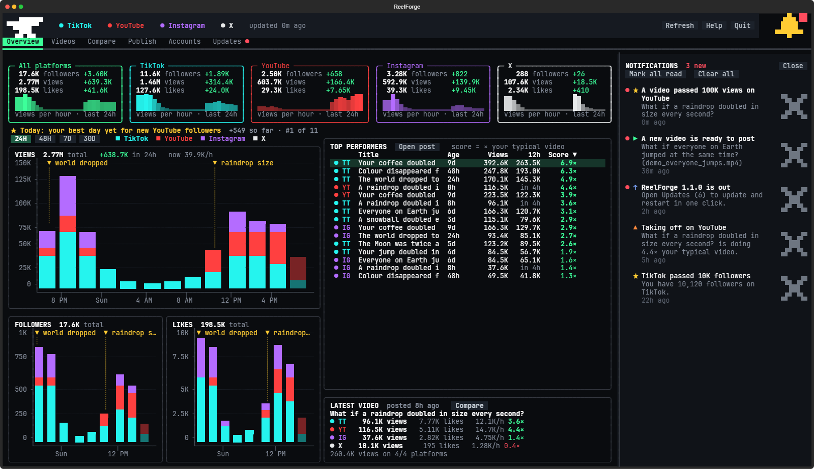
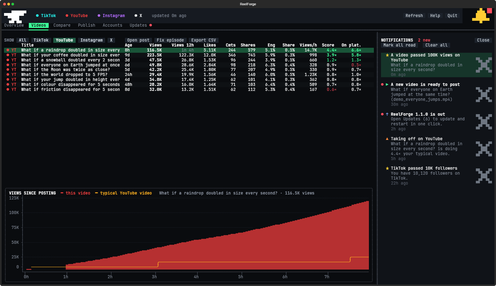
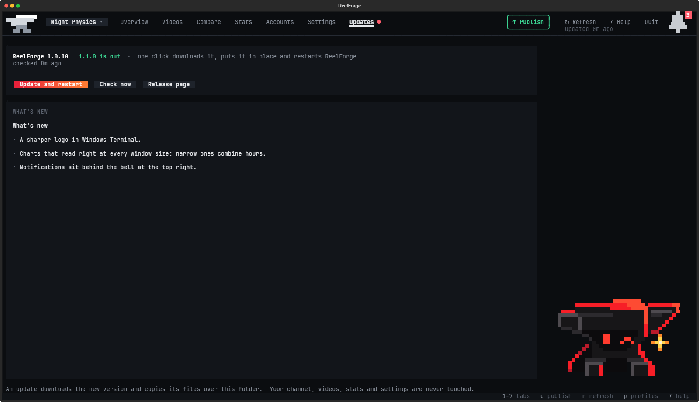

# The ReelForge window

This is what opens when you type `reelforge` in a terminal (or use the ReelForge shortcut): your stats on TikTok,
YouTube, Instagram and X, the **Publish** tab where every finished video waits for you to post it, a notifications
drawer, and one-click updates. ReelForge never posts anything itself.

## Opening it

| Type this | and you get |
|---|---|
| `reelforge` | the Overview |
| `reelforge 1` … `reelforge 6` | straight to a tab: 1 Overview, 2 Videos, 3 Compare, 4 Publish, 5 Accounts, 6 Updates |
| `reelforge videos`, `reelforge publish`, … | the same, by the tab's name (`post` and `upload` work for Publish, `login` for Accounts) |
| `reelforge notifications` | the Overview with the notifications drawer open |
| `reelforge --demo` | a tour on made-up numbers: nothing is read or saved |

ReelForge shows only the platforms you've connected: onboarding connects the ones you give it a handle for, and
**Accounts (5)** connects (or disconnects) any of them later. TikTok and YouTube stats start straight away; Instagram
and X need **Log in** once (see below). With nothing connected yet, ReelForge opens on Accounts. It looks best in
Windows Terminal with the window maximised.
Everything is a button on the page it applies to, for the mouse or the keyboard: **1**-**6** switch tabs, **r** / **R**
refresh / force a refresh, **Tab** moves between buttons, lists and fields (**Enter** presses, the arrows move through
a list), **Esc** closes the drawer or a dialog or leaves a text field, and **Ctrl+Q** quits.

The window is an [OpenTUI](https://github.com/anomalyco/opentui) app (`ui/` in the ReelForge folder), run by Bun; setup
puts Bun in `tools/bun` and the window's packages in `ui/node_modules`, and ReelForge gets them again by itself if
they're ever missing (an update that needs new ones, say).

You can have ReelForge open in several windows at once, each on its own tab (the Overview in one, Publish in
another). They share one set of stats: one window reads them at a time, with **refreshing …** in every window's top
bar meanwhile, and as soon as it's done every window shows the new numbers, notifications and errors. The hourly
background job's reads show up the same way. **r** in a window while another one is reading waits for that read
instead of reading everything again.

On Windows, ReelForge also adds itself to Windows Terminal: opened from the desktop shortcut or the Start menu, its
tab is called ReelForge and shows the anvil, and **ReelForge** is in Terminal's **+** menu. Terminal picks this up the
next time it starts. A tab you type `reelforge` into is called ReelForge too, but keeps that tab's own icon.

## The six tabs

| Tab | What's on it |
|---|---|
| **1 Overview** | A card per platform (and all of them added up): followers, views, likes, the change over 24 hours and views per hour. Under the cards, today's **badges** (below). Then **views**, **followers** and **likes** gained over time, stacked by platform: each bar is the shortest stretch the window has room for (an hour on 24H when it's wide enough, a few hours or a day on the longer ranges), with yellow ▼ marks where each video went up, your **top performers** (with their views 12 hours in) and how your **latest video** is doing. |
| **2 Videos** | Every video on every platform: views, **views 12 hours in** (so new and old videos compare fairly; "in 5h" until a video is that old, — when the computer was off then), likes, comments, shares, engagement, share rate, views per hour and score. Click a header to sort. Above the chart, the highlighted video's **badges**. **Fix episode** if a post was grouped with the wrong video; **Export CSV** saves everything as a spreadsheet, with when each post went up (date, weekday, hour and UTC time) and its views 1, 6, 12 and 24 hours in. |
| **3 Compare** | The **platform scoreboard**, or one video side by side on every platform against that platform's typical video. |
| **4 Publish** | Finished videos, newest first, with the platforms each one is already on. Pick one, check the caption and hashtags (the preview shows exactly what each platform gets), then use the platform buttons. Under the list, the **best time to post** on each platform. |
| **5 Accounts** | Every platform: **Connect** one with your @handle (or **Sign up** for one you don't have yet: it opens the platform's own sign-up page, with the steps beside it) and **Disconnect** one you've stopped using (its stats stay saved). For a connected one: where its stats come from, when they were last and will next be read, the last error if any, **Log in** (Instagram, X), **Open profile** and **Refresh now**. |
| **6 Updates** | Your version, what's new in the next one (or in yours, when it's the newest), and **Update and restart**. |

**Score** is how a video compares with your typical video at the same age, across every platform: 1.0× is normal and
3× is a hit. **Engagement** = (likes + comments + shares) ÷ views. **Share rate** = shares ÷ views, the strongest
sign a video is spreading.

## Notifications

The **bell** in the top-right corner opens the drawer on the right; the bell, **Close** or Esc
closes it. A **red dot** on the bell means something's unread (the drawer says how many); **Mark all read** clears
it. The big **×** on a notification's right deletes it (Delete does the same for the highlighted one), and **Clear
all** deletes every one. Click a notification to see what it's about, from any tab (the drawer stays open, so you
can go through them):

| You hear about | Clicking it shows |
|---|---|
| a video **taking off** (3× your typical one in its first 12 hours), passing 1K, 10K, 100K, 1M … **views**, or moving up to a better **badge** | the **Videos** tab with that platform's videos, the video highlighted (scrolled to if it's far down) and its chart underneath |
| a **finished video** that's ready to post | the **Publish** tab with that video picked, its caption and hashtags filled in |
| a platform passing 100, 500, 1K, 5K, 10K, 25K, 50K, 100K … **followers** | that platform's panel on **Accounts**, framed in yellow for a few seconds |
| Instagram or X **logging ReelForge out** | that platform's panel on **Accounts**, with **Log in again** ready to press |
| **today's badge** on a platform, or your **views across every platform** passing 1K, 10K, 100K, 1M … | that platform's card (or **All platforms**) on the **Overview**, framed in yellow |
| a **new version** of ReelForge (once per version), or ReelForge having **updated** | the **Updates** tab, with what's new |

With the hourly background job on (onboarding asks; `reelforge stats on`), ReelForge reads your stats while it's
closed too, so the drawer has news waiting when you open it. Nothing is told twice, so one you deleted stays
deleted, and the first look at a new account only takes stock: old milestones are never announced as new.

## Badges

"Top 5% of your TikTok videos for views", "Today: your best day yet for new YouTube followers". Badges compare you
with **yourself**, from the numbers ReelForge has stored, so they're always true:

- a video against your other videos on the same platform, for views, likes, shares and views in its first day (its
  reading 23-26 hours after it went up);
- today so far against your earlier days, for new followers and views on each platform (days ReelForge was only
  partly reading are left out).

Percentages (top 25%, 10%, 5%, 1%) need at least 10 videos or days to compare; before that a badge only says "your
best … yet", and only when it really is. Ties count against you. Moving up a tier adds a notification.

There are no "top X% of all creators" badges: no platform publishes how big its creators' accounts are, and no
outside study can back such a claim yet (`badges.py` lists the ones checked).

## Updates

The **Updates** tab checks for a new version when ReelForge opens (every few hours at most; the background job
checks too, so the bell tells you). **Update and restart** downloads it, puts it in place and opens ReelForge again:

- installed with the Windows installer: the new installer runs quietly into the same folder;
- installed from a download (zip): the new files are copied over the old ones;
- a git copy: `git pull` (only when you haven't changed files yourself).

Your channel (`my-studio/`), videos (`episodes/`, `completed videos/`), stats, logins, settings and downloaded tools
are never touched, and your `CLAUDE.md` / `AGENTS.md` are rewritten from your onboarding answers with the new
version's instructions. If anything goes wrong, the version you have keeps working. From a terminal:
`.venv\Scripts\python -m studio.update` (add `--apply` to install).

## How ReelForge reads your stats

| Platform | How | What you get |
|---|---|---|
| TikTok | your public profile, in a background browser (no login) | followers, total likes, and each video's views, likes, comments, shares and saves |
| YouTube | your public channel page and feed | subscribers (once YouTube shows the count), and views and likes of your latest videos |
| Instagram | **log in once** (Accounts tab) | followers, and each Reel's views, likes, comments and shares |
| X | **log in once** (Accounts tab) | followers, and each video post's views, likes, replies, reposts and bookmarks |

**Log in** opens a window of ReelForge's own browser, with its own profile in `dashboard/data/browser`, separate
from your normal browsing. ReelForge uses Edge on Windows and Chrome on macOS and Linux (or Edge, or a Chromium setup
downloads when there's neither), and keeps using the one it started with. Log in there once and ReelForge closes it
and carries on; after that it opens your profile in the
background about once an hour and reads the numbers the page shows you. It never posts, likes or follows anything.
These are the same pages a browser loads, so a site redesign can break a reader until ReelForge is updated. If a
login ever stops working, **Type in stats** (on that platform's Accounts panel) opens a box to type numbers in by
hand.

Platforms report lifetime totals, so ReelForge saves a snapshot every time it reads them and builds the charts from
those snapshots: they fill in the longer it runs. **Background stats** (`reelforge stats on`, or onboarding's
question) keep them filling in while ReelForge is closed: a small job wakes once an hour, reads your stats in a
hidden browser for about a minute, and exits. `reelforge stats off` stops it. Each run adds a line to
`dashboard/data/refresh.log`.

## The Publish tab

It lists every finished video from the pipeline (`episodes/<id>/final/<id>.mp4` and `completed videos/`), plus any
video you drop into `dashboard/videos/`. Picking one fills in the caption (the episode's `title`) and its hashtags.
What each platform gets follows your channel's caption rules from onboarding: the caption plus hashtags on TikTok
(your first hashtag, usually #fyp, always leads) and Instagram, the caption as the YouTube title with the hashtags as
its description, and the caption alone on X unless you allowed hashtags there.

Each platform button copies that platform's text, shows the file in Explorer, Finder or your file manager (drag it
into the upload page) and
opens the upload page. **Open all** opens every page with the TikTok text copied; use the Copy buttons for the
others. ReelForge looks for the new posts 10 and 30 minutes later and matches them to the video by their caption.
**Remove** above the list (or a right-click on a video) hides it from the list or moves it to the Recycle Bin (the
Trash on a Mac or Linux PC);
**Show hidden** brings hidden videos back.

**Best time to post**, under the list, shows each platform's best part of the day so far (12–4 AM, 4–8 AM,
8 AM–12 PM, 12–4 PM, 4–8 PM or 8 PM–12 AM, in your computer's time zone): the one whose videos got the most views in
their first day, its typical video against your other times, and when it next comes round. It needs two videos a day
old in each of two parts of the day, and names one only when its typical video beats the next part's by a fifth or
more; until then it says there aren't enough videos yet, or that no time is clearly better yet, with the numbers so
far. A video's first day counts when ReelForge was reading around then (the computer was on). With few videos, which
video it was matters more than when it went up, so take it as a time to try rather than a rule.

## Settings (`dashboard/config.toml`)

| Setting | |
|---|---|
| `handle` under `[tiktok]`, `[youtube]`, `[instagram]`, `[x]` | your handle on each platform: **Connect** on the Accounts tab sets it and **Disconnect** clears it; blank leaves the platform out everywhere |
| `default_tags` | hashtags for videos that don't bring their own |
| `refresh_minutes` | how often ReelForge re-reads stats while it's open (Instagram/X wait at least an hour) |
| `videos_dir` | an extra folder of videos to post (default `dashboard/videos`) |

Onboarding writes this file; run onboarding again to change your answers, or edit it and reopen ReelForge. Connecting
or disconnecting a platform on the Accounts tab changes your onboarding answers to match, so your AI's notes cover the
platforms you're connected to and running onboarding again keeps them.

## Your data

Everything stays on this computer in `dashboard/data/`: `stats.db` (snapshots, posts, the upload log and your
notifications), a dated backup of it in `dashboard/data/backups/` once a day, and `dashboard/data/browser/`
(ReelForge's browser profile with your Instagram/X logins: keep it private, never share or upload it).

## Troubleshooting

| Problem | Fix |
|---|---|
| ReelForge says it needs its Python environment | Run setup again (`setup.bat`, or `./setup.sh`). |
| "ReelForge's window couldn't run" | It says why, and the details are in `dashboard/data/window-log.txt`. `reelforge doctor` checks Bun and the window's packages; `reelforge setup` puts them right. |
| A platform's name is red in the top bar | The Accounts tab shows the error. TikTok sometimes shows a captcha to a background browser: ReelForge tries again next time. |
| Instagram "wants to check it's you" | Press **Log in again** and follow Instagram's steps in the window that opens. |
| A finished video isn't in the Publish list | Run `reelforge publish-check episodes/<id>` in the ReelForge folder: it says what's missing. |
| A post is grouped with the wrong video | Videos tab: highlight it and press **Fix episode**. ReelForge keeps your choice. |
| An update didn't finish | The message on the Updates tab says why; the version you have keeps working. Try again, or download the new version from the releases page. |
| `config.toml has a typo` | Fix the line it names, or delete `dashboard/config.toml` and run onboarding again. |

## Files

| | |
|---|---|
| `service.py`, `view.py` | what the window shows and what its buttons do; the window itself is the OpenTUI app in `ui/` (`ui/README.md`), which runs this through `studio/bridge.py` |
| `__main__.py`, `sync.py`, `analytics.py`, `trends.py`, … | opening it, reading stats (httpx, and Playwright with an installed browser), and the numbers behind every chart |
| `notify.py`, `badges.py`, `besttime.py` | notifications, milestones, badges and the best time to post |
| `refresh.pyw` | what the hourly background job runs |
| `config.example.toml` | the settings template; your own settings are in `config.toml` (written by onboarding, not shared) |
| `tests/` | from the ReelForge folder: `.venv\Scripts\python -m unittest discover -s dashboard/tests -t .` (macOS/Linux: `.venv/bin/python`); the window's own tests are in `ui/test/` (`bun test` in `ui/`) |
| `data/` | your stats database, backups and ReelForge's browser profile: private, never shared |
